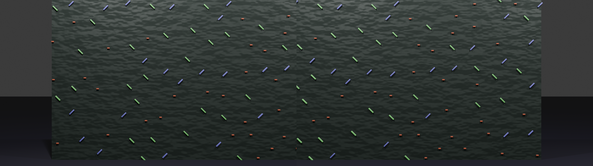
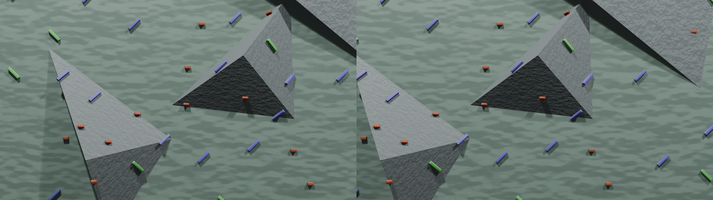
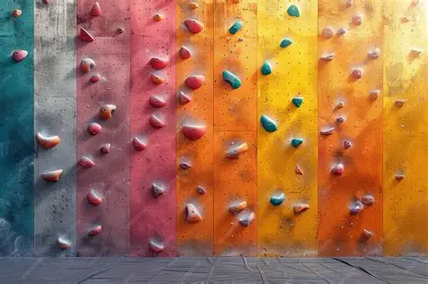
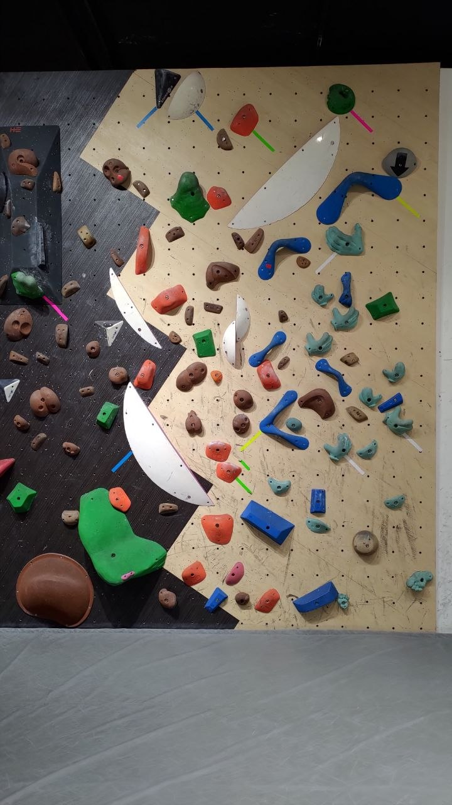

# Perception Challenge

The goal of the perception challenge is to:
 
    1.) find the holes in a global view of a climbing wall,
    1.) find the type, position, and orientation of each hold,
    1.) find the exact position and orientation of the robot on the wall.

This challenge is ideal for students that have little prior experience in robotics and motion planning.

## Images

There are two types of images used in this challenge: (a) synthetic images created in simulation, and (b) images of real climbing walls.

### Synthetic Images

In the first part of the challenge, we will use synthetic images taken by a virtual stereo camera pair as shown below. 
There are three different types of holds: a center hold - can be gripped from any direction (red), a left hold - must be gripped with the center of mass of the robot to the right of the hold (blue), and a right hold - must be gripped with the center of mass of the robot to the left of the hold (green).

The three types of holds will have different colors, but the chosen color can vary from image to image.

<table>
  <tr>
    <td></td>
  </tr>
</table>

There are three types of challenges of increasing complexity

    1.) The wall is a plane mounted perpendicular to the floor,
    1.) The wall is a plane, but is mounted as a sloper or overhang,
    1.) The wall is a plane that may not be perpendicular and it includes several large extrusions (volumes) of different colors. The holds are
    mounted on the faces of the volume, hence their pose may include roll, pitch, and yaw.

The image below shows a wall with volumes as an example.

<table>
  <tr>
    <td></td>
  </tr>
</table>

### Real Images

In the later part of the challenge, we will include images of real climbing walls taken from the internet or the SMART bouldering facilities.

<table>
  <tr>
    <td></td>
    <td></td>
  </tr>
</table>

## Evaluation

Teams will be given a set of images as training data at the beginning of the round. 
A distinct set of validation images will be used to evaluate the system.

For each image, the team must generate a json file as follows:

<code>
<pre>
{
    "hold_<num>": {type: "<type>", x: <real_world_x>, y: <real_world_y>, z: <real_world_z>, "euler_xyz": { roll: <roll>, pitch: <pitch>, yaw: <yaw>} },
    "hold_<num>": {...}
    ...
}
</pre>
<code>

Type should be center, left, or right.

All position arguments should be in millimeters. The origin of the coordinate system is given by a red square in the image. The bottom left
corner of the square is at the origin and the dimension of the square is 1000mm by 1000mm. The position values will be rounded to rounded to integer values for the comparison.

All angles are given in radians.

The score of the submission will be based on a weighted sum of the following criteria:

    1.) the number of holds that were detected with the correct type in approximately the correct location +/- 50mm,
    1.) the sum of the squared errors over all correctly detected holds,
    1.) the squared error of the difference between the detected and correct pose.

